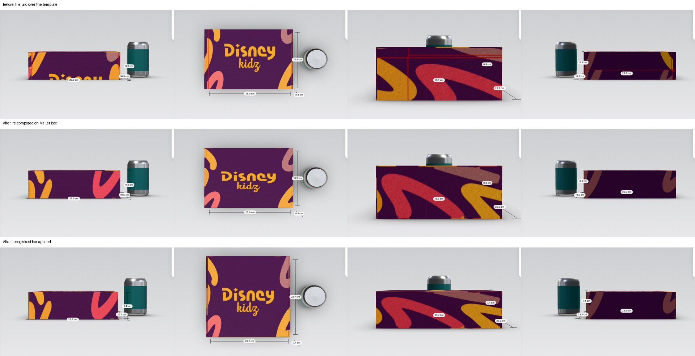

# Dieline remap: a buyer's own printer template, mapped onto the closed box (2026-11-10)

Owner's ask: when a buyer uploads a dieline image made on their printer's template (not Elba's), Elba must detect which box it is and map the art so the CLOSED 3D box looks right: every face that shows carries the right part of the art, with no seams, slivers or wrong strips. The flat sheet does not have to match the upload 1:1.

Inputs: `docs/owner-input/2026-11-10/` (outside dieline, inside dieline, closed-box mockup, two seam screenshots) and the detector in `src/components/designer/lib/dielineDetect/`, which existed but was not wired in.

Top row: before (the file laid over Elba's sheet as it is). Middle row: the same file re-composed on the open Mailer box. Bottom row: the recognised box applied. Views are front, top, left and back.

## What the buyer sees

1. In Artwork > Full artwork, the buyer uploads the file. The file shows right away at full size, as before.
2. "Reading the cut and fold lines in your file" shows while the Web Worker works (about 2 s on the owner's files; the worker is started when the section opens).
3. The card reads "We recognised: Lock-corner bakery box, 22.3 × 23.4 × 7.1 cm". Below it: "Your design was arranged on this box's template, face by face. Your file is kept as it is." The 3D view already shows the re-composed art on the box that is open, whatever its model.
4. When the file has no print size (the owner's files are 72 dpi webp), the card says so and offers ONE field, "Lid length (cm)". Typing 26 sets 26 × 27.3 × 8.3 cm from the proportions.
5. "Use this box and size" switches the model and size and keeps the art; the sheet is made again for the new template. Up to 3 other close matches are listed; picking one moves it into the card.
6. No model scores 0.6 (`FOUND_SCORE`): the six faces are found by topology and placed on the open box. The card then says "No box model matched, so each of the six faces of your drawing was placed on this box", and the existing fit check runs on the file as uploaded.
7. No lines found, or the worker fails: the file stays as uploaded (old behaviour) with a note.

Arabic follows CLAUDE.md: MSA, noun-form labels («اعتماد هذه العلبة وهذا المقاس», «طول الغطاء (سم)»), no diacritics, Western digits, «سم» after sizes. Screenshots: `card-en.png`, `card-ar.png`.

## How it works

New module `src/components/designer/lib/dielineRemap/` (pure TS, no DOM; it runs in the detector's worker and in Node tests).

1. **Detect and rank** (`recognise.ts`, `rank.ts`). The detector runs on every box model except FEFCO 09 fittings, which go inside another box and are never a printed sheet. Each candidate now carries its fitted dims and its placement (template sheet mm to image px; `DetectCandidate.fitDims`, `.transform`). The designer ranks by the detector's score plus a **face agreement** term: does the candidate's closed box take each visible face from the same panel of the art that the topology reading (step 5) says forms that face? This is what tells the owner's mailer from the collapsible rigid box, whose front flap covers the front when closed (same die, wrong faces). Weight 0.15, centred on 0.75 agreement.
2. **Snap** (`correspond.ts` `snapPanels`). Each panel box of the fitted template is snapped to the nearest drawn line within a gate (at most 30% of the panel, 4% of the die). Lines are grouped by position, and a group must cover 35% of the edge. So a printer template with another tuck depth or other flap shapes still maps edge to edge. The sizes to apply come from the snapped lid and front wall (`snapRatios`), not the raw fit.
3. **Closed-pose correspondence** (`closedFrames`, `pairPanels`). Each printable panel of Elba's model and of the candidate is placed where the fold engine puts it in the CLOSED box, normalised to a unit cube. Elba's panel takes the candidate panel with the same facing (normals within about 11°) and the same depth below the outer face, with a small preference for the same role. The map is affine: Elba sheet mm to the closed box to candidate sheet mm, then through the snap correction to image px. It reads only fold poses every model has, so it works on any model, including the -bags and -mailers sessions' new models once merged. Faces adjacent in 3D but not in the flat keep the art as drawn; no continuity is invented.
4. **No counterpart** (`completePlan`). For example, Elba's FEFCO_0427 rolled-in front wall: the owner's template has a single front. Such a panel takes its parent's art mirrored across its hinge, so the art stays continuous round the fold; it is hidden when closed. A root with no match borrows from a child, and only a model with nothing to borrow gets the art's mean colour.
5. **Faces fallback** (`faces.ts`). Rectangular cells bounded by drawn lines form a partition, with the best-drawn cells first and none overlapping. Base and lid are the two biggest similar cells joined through one wall (the back). The base is the one whose walls run its full edges and carry more panels (rolled walls, ears). Front is opposite the back, and left and right follow from it (swapped for an inside print). Each face gets its outside-view frame and is mapped rect to rect onto the open model's face parts.
6. **Compose** (`compose.ts`). The die lines are painted out of the art first: a band round each detected line takes the colour just beyond it on its own side, then die-coloured marks near a line (doubled strokes, registration marks) are grown over. Then the sheet is re-composed in Elba's layout at the art's own density (at least 3, at most 12 px/mm, at most 7000 px). Every pixel belongs to the panel it lies in, or past an edge to the nearest panel. Bleed past a cut may sample into the source panel's neighbour only when that neighbour shares a fold with it in the source; otherwise the edge pixels extend. The inside comes out mirrored, as the inside template shows it.
7. **Inside and outside.** Both slots work the same way. An inside print is read as drawn on the inside template (mirrored). When the die is the same both ways round (most mailers, so the detector's mirror bit is a coin toss), the transform is flipped to the slot's reading, so left and right walls get the right art (`mirrorSymmetric`, which pairs left with right).
8. **Storage** (`src/types/design.ts`, `lib/doc.ts`). `SheetImage.original` is the upload at the detector's working size (at most 2400 px, JPEG, under 2.5 M characters). `SheetImage.remap` holds the mode, the code, a `target` key (model, size, board, features, surface) and the recipe (transform, snapped boxes, lines, line width, faces). `src` is the re-composed sheet, so 3D, preflight and the print PDF use it unchanged (Elba's printer cuts Elba's die). When the model, size, board or features change, `useSheetRemap` makes the sheet again from the original in the worker. Preflight and the low-resolution note use the art's own density on the faces (`remap.sourcePxPerMm`), not the upsampled sheet's.

## Results on the owner's files

Node 22 on the session container, single thread. "Total" is detect, rank and remap onto FEFCO_0427 at 250 × 180 × 80; `prepareModels` takes 1.4 s once per worker. Face checks compare each closed face of the re-composed sheet with the same face of the upload found by topology (16 × 16 grid, 10% inset): the largest per-channel mean colour difference (0 to 255) / the luminance correlation.

| File | Top match (score, agreement) | Next | Total | On FEFCO_0427: top, bottom, front, back, left, right |
|---|---|---|---|---|
| Outside, purple, 1033 × 1309 | FS_BAKERY_BOX (0.684, 0.93) | RIGID_COLLAPSIBLE (0.693, 0.75), FEFCO_0421a, FEFCO_0427_1 | 2.1 s | 1.1/0.99, 0.6/0.99, 0.4/1.00, 0.6/0.99, 0.3/0.98, 0.4/0.99 |
| Inside, pink, 1049 × 1303 | FEFCO_0421_1 (0.665, 0.97) | FEFCO_0428, FEFCO_0421, FEFCO_0429 | 1.7 s | 0.4/0.98, 0.3/1.00, 0.3/0.99, 0.2/0.99, 1.5/0.98, 0.4/0.98 |
| Sample jpg, 1244 × 1600 | FS_BAKERY_BOX (0.747, 0.95) | FEFCO_0421_1, FEFCO_0421, FEFCO_0426a | 1.9 s | 2.3/0.90, 0.4/0.98, 0.1/1.00, 0.2/0.99, 1.5/0.95, 1.3/0.99 |

- Every top match is the owner's construction: a hinged tuck lid with side flaps, double end walls with locks, and ears. Before the face agreement, the collapsible rigid box led on the purple file (0.693 against 0.684); its closed front is the lid's flap, so it would have put the tuck's art on the front.
- On the recognised model itself the face figures are the same or better (purple: 0.3 to 0.8 / 0.98 to 1.00).
- Every target panel maps. On FEFCO_0427 only `frontInner` is mirrored from its parent, since the owner's front wall is single; nothing falls back to the mean colour.
- Sizes from the snapped panels: the lid's L/W and the front's H/L agree with the drawn panels within 2% on all three files. Without the snap refinement the purple file was 10% off on one ratio.
- The art's own density is 1.6 to 2.4 px/mm at the estimated sizes, so the low-resolution note (47 to 61 dpi) is correct for these files: they are screen previews, not print files.
- The jpg sample's lid is the weakest face (correlation 0.90). The sample is drawn upside down and its lid carries fine text and a QR code next to the die lines.

Playwright (`e2e/dieline-remap.spec.ts`, desktop, production build, 50 s): it uploads the purple file on /en/design/mailer-box, sees the recognised card (a mailer-group code, no aspect-ratio warning), types a 26 cm lid, applies, and checks that the URL moves to the new model and that the saved design has the original, a fresh remap target and L = 260 mm. It writes `e2e-mailer-*.png` and `e2e-applied-*.png` (front, top, left, back). Compared by eye with `mockup-closed-views.webp`: the lid carries the centred logo with the swirls round it, each wall carries its own strip, and no die lines or wrong strips show. The mockup's own art differs from the dieline file (its left side is pink there), so only placement can be compared.

## Today's seams (`seam-lid-front.png`, `seam-corner.png`)

Found by reproducing both with a full-sheet photo (no die lines) on the mailer.

1. **Art breaks at the lid's front edge and across the corner.** The root cause is the sheet layout, not the renderer. A full artwork covers Elba's sheet (`sheetImagePlacement`). On a mailer the lid's front edge sits about 530 mm from the front wall's top on the sheet, and the front and side walls are not adjacent at all. A photo can never be continuous there, and a printer template drawn for another layout lands its panels on the wrong parts of Elba's sheet: before, the lid's logo ran onto the front wall and the red die lines landed on the left wall. The remap fixes it for any upload with a dieline: each face takes its own panel of the upload. A plain photo keeps its art as drawn (per the brief: no invented continuity).
2. **Line along the top edge, and the lid tinted.** This is the hover glow (`src/components/three/pickHighlight.ts`): an additive tint over the face under the pointer and a blue outline of its edges, which reads as a seam on printed art. Fixes: the glow is now hidden during every screenshot, export and proof render (`withoutHighlight` in `screenshot.ts`), and a plain mouse hover over a surface that carries a full artwork shows the "click to add an image" hint without the glow. Drag-over and tap feedback still glow.
3. **Slivers of hidden flaps.** Where a tuck, dust flap, rolled-in wall or ear turns over its crease, a sliver of it shows at the lid's front edge and the corners, carrying whatever that flap's part of the sheet holds. The sheet painting now gives that band (2 mm plus twice the board thickness) the face's art mirrored across the crease (`foldStrip` in `src/lib/dieline/texture.ts`, full artwork only). The print PDF paints through the same function, so the real box gets the same fold wrap. The geometry snapshot is unchanged.

## Also fixed on the way

- **A full artwork did not survive a reload or reach the print PDF.** `loadDesign` (`src/components/designer/server.ts`) rebuilt each surface from background and layers only, so `sheetImage` was dropped on every load, and the print PDF is made from the stored design. It is now read back through `sheetImageSchema`. The new spec covers it.
- **The detector client waited for ever when the worker failed to load.** Every waiting job, and every later one, now fails, and the plain upload stays.

## Limits

- **Owner's mailer vs Elba's FEFCO_0427.** The owner's construction has a single front wall; Elba's FEFCO_0427 rolls a second front wall in. On FEFCO_0427 the remap mirrors the front's art onto that inner wall, which is hidden when closed but visible inside the open box. Inside the open box, the inside of the front shows that rolled wall's outside print, because that is Elba's construction. The roll end tuck front (RETF) mailer from the -mailers session is the right target. The remap needs no change for it: once that model is in the library, the detector can rank it, and if it is the top match, applying it gives a 1:1 panel match. The spec already accepts `FEFCO_0427_RETF` in the mailer group. Check the exact code after merge.
- **Size without a print size in the file** is the nearest standard size of the matched model at the art's proportions, until the buyer types the lid length.
- **Curved and diagonal die lines** (rounded dust flaps, ear tapers) are not detected segments, so they are not painted out. They lie on hidden flaps; on the owner's purple file a few red pixels of a registration mark remain on the dust flap at the lid's back corner.
- **Faces mode** reads hinged-lid constructions (base plus four walls plus lid). Slotted cases (RSC) and others return no faces, and the file stays as uploaded with the fit check.
- **Perspective photos** of a template are out of scope: lines must be within ±3° of axis-aligned, as in the detector.
- **Rendering:** the closed 3D tone-maps the owner's flat purple and pink a little darker and warmer than the mockup. That is the board and light model, not the mapping.
- **Arabic layout:** in the recognised card's alternative buttons, the size (an LTR isolate, the same `formatSheetCm` the fit check uses) can wrap mid-size on a narrow panel.
- **Undo:** re-making the sheet after a size or model change is a separate step, so undoing a size change can come back to a stale sheet, which is then made again (and clears redo).
- **Bundle size:** `npm run test:size` reports 6 vendor and admin pages over the 200 KB budget. The base commit (`c47c9e6`) reports the same 6 pages, so this work did not add it. The designer chunk carries the remap only inside the worker.

## Files

- New: `src/components/designer/lib/dielineRemap/` (`index.ts`, `types.ts`, `correspond.ts`, `compose.ts`, `faces.ts`, `rank.ts`, `recognise.ts`, `__tests__/remap.test.ts`), `src/components/designer/useSheetRemap.ts`, `src/components/designer/RecognisedCard.tsx`, `e2e/dieline-remap.spec.ts`, `docs/screenshots/audit/dieline-remap/`.
- Changed: `dielineDetect/` (`detect.ts` fitDims and transform per candidate, `types.ts`, `worker.ts` recognise and remap messages with JPEG encoding, `client.ts`), `DesignerApp.tsx`, `SheetArtwork.tsx`, `sheetArtwork.module.css`, `lib/doc.ts`, `lib/preflight.ts`, `server.ts`, `src/types/design.ts`, `src/lib/dieline/texture.ts`, `src/components/three/pickHighlight.ts`, `src/components/three/screenshot.ts`, `src/i18n/designer.{en,ar}.ts`, `src/i18n/scopes.generated.ts`.
- Not touched: `src/lib/dieline/families/**`, `src/lib/library/packs/**`, the geometry snapshot.

## Checks

- `npm run typecheck`: clean. `npm run lint`: clean.
- `npx vitest run src/components/designer src/lib/dieline src/i18n`: 49 files, 6250 tests passed (includes the 20 new remap tests: 3 owner files × 5 checks, the inside mirror check, 4 synthetic cross-model remaps).
- `npx tsx scripts/generate-i18n-scopes.ts --check`: up to date.
- `npx playwright test e2e/dieline-remap.spec.ts --project=desktop --trace off`: 1 passed. `e2e/designer.spec.ts --project=desktop`: 9 passed, 1 skipped (the mobile-only test).
